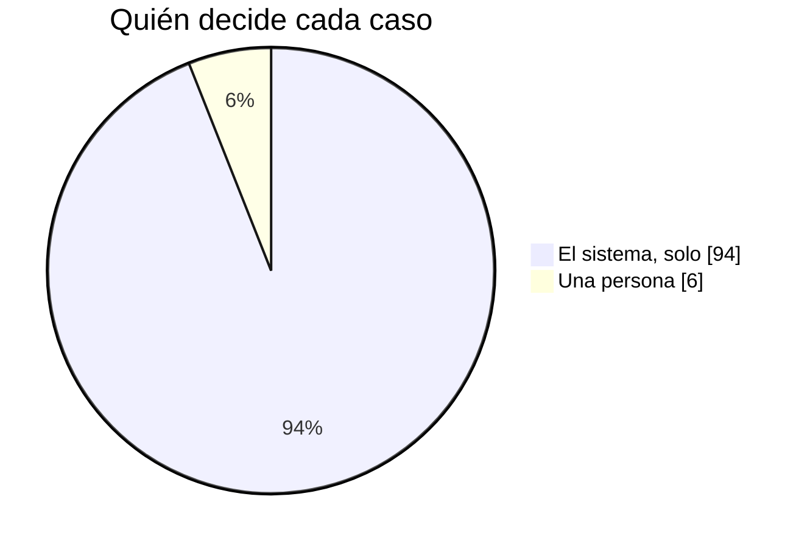
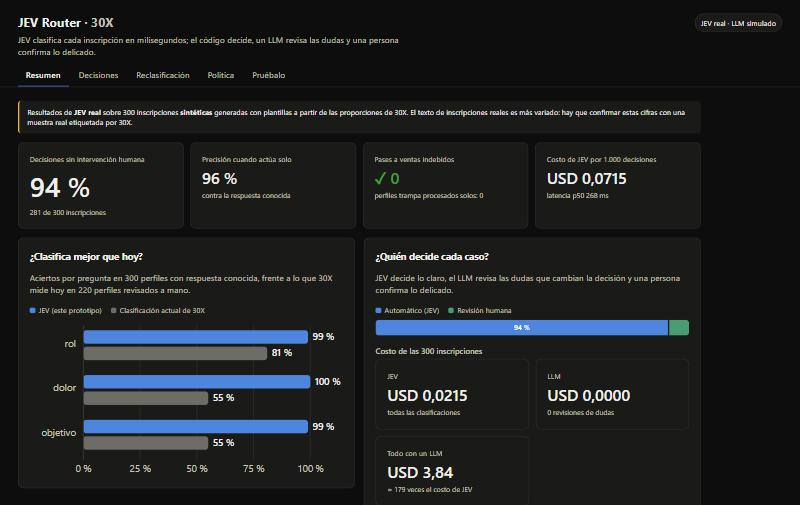

# Playbook: JEV en 30X

**Cada persona, en el segmento correcto, en el momento correcto.**
Clustering dinámico con JEV: el segmento de cada persona se actualiza solo, cada vez que dice o hace algo nuevo.

Versión en diapositivas: [Playbook JEV en 30X](https://claude.ai/artifact/C8hRhbCZKiZgy2LfEvPLLm) (8 slides; se exporta a PDF o PowerPoint desde *Share › Export*).
Octubre de 2026 · Resultados medidos con JEV real (`jev-1.13.0`).

---

## 1. La oportunidad: hoy 30X ve una foto, las personas son una película

| Lo que 30X sabe hoy de cada persona que llega | % |
| --- | --- |
| Su rol | 27 % |
| Qué le duele | 15 % |
| Su país | 3 % |

- La clasificación actual acierta **55 %** en qué le duele a cada persona y qué busca (81 % en el rol).
- El segmento se asigna **una vez**, al inscribirse, y no cambia aunque la persona cambie.

*Fuente: muestra de 697 perfiles anonimizados que compartió 30X, proporcional a una base de unas 32.300 personas.*

## 2. La propuesta: el segmento se mueve con cada cosa que la persona dice o hace

| Momento | Lo que pasa | Segmento |
| --- | --- | --- |
| Día 0 · Se inscribe | «No tenemos un proceso de ventas, todo depende de referidos» | Sales Machine · recibe contenido |
| Día 7 · Responde un correo | «¿Cuánto cuesta? Me gustaría una llamada esta semana» | **Lista para hablar · pasa a un asesor** |
| Día 20 · Asiste a un taller | Sin escribir nada: su participación también cuenta | **Compromiso alto · sube su prioridad** |
| Día 45 · Cambia de cargo | «Ahora soy la CEO de la compañía» | Decisora · Inmersión Ejecutiva |

El equipo comercial habla con quien está lista para comprar. El resto recibe el contenido de su momento, no el de hace tres meses. Cada cambio queda registrado con el motivo que lo causó.

## 3. Qué gana 30X

- **Ventas más enfocadas:** los asesores solo reciben a quien muestra intención real de compra, en el momento en que la muestra.
- **Menos trabajo manual:** el 94 % de las decisiones se toman solas, en menos de un segundo. El equipo solo ve lo dudoso.
- **Contenido que sí sirve:** cada persona recibe lo que corresponde a su momento actual.
- **Decisiones que se explican:** cada caso dice qué se decidió y por qué, en una frase.

## 4. Por qué funciona: entiende a cada persona mejor que la clasificación de hoy

| Pregunta | Clasificación actual de 30X | Con JEV |
| --- | --- | --- |
| Qué rol tiene | 81 % | **99 %** |
| Qué le duele | 55 % | **100 %** |
| Qué quiere lograr | 55 % | **99 %** |

- **0** personas pasadas a ventas sin estar listas.
- **96 %** de las decisiones automáticas, correctas. Los errores restantes son de bajo riesgo: contenido general en lugar del de un programa, o al revés.

*Medido con JEV real sobre 300 inscripciones sintéticas con las proporciones de 30X. Hay que confirmarlo con una muestra real: el texto real es más variado y, con 300 casos y cero errores graves, la tasa real podría llegar hasta 1 %.*

## 5. Cómo decide en instantes: tres pasos, menos de un segundo

1. **JEV lee y responde.** Seis preguntas cerradas sobre lo que escribió la persona, en una sola consulta de 0,3 segundos.
2. **Las reglas de 30X deciden.** Las respuestas se convierten en segmento, programa y siguiente paso. 30X ajusta las reglas sin programar.
3. **Una persona, solo si hace falta.** Si JEV duda en algo que cambia la decisión, o si el siguiente paso es ventas, confirma el equipo.

**Las seis preguntas**

| Pregunta | Tipo de respuesta |
| --- | --- |
| ¿Qué rol tiene? | Una opción entre 7 (fundador/CEO, C-level, líder comercial, gerente, técnico, otro, sin dato) |
| ¿Describe un problema de su negocio? | Sí / no, con probabilidad |
| ¿Cuál es su problema? | Una opción entre los 9 dolores que usa 30X + ninguno |
| ¿Qué quiere lograr? | Una opción entre los 10 objetivos que usa 30X + otro |
| ¿Qué tan lista está para comprar? | Escala: sin intención · explorando · evaluando · lista para conversar |
| ¿Es una inscripción real? | Sí / no, con probabilidad (frena spam y textos con instrucciones al sistema) |

**Umbrales**

| Situación | Umbral | Qué pasa |
| --- | --- | --- |
| La inscripción no parece real | probabilidad < 0,35 (calibrado con JEV real) | Una persona revisa |
| JEV duda en rol, problema u objetivo y la duda cambia la decisión | certeza < 0,45 | Revisión (un LLM opcional primero; si tampoco está seguro, una persona) |
| Intención de compra no concluyente | probabilidad de estar lista entre 0,5 y 0,8 | Una persona confirma antes de ventas |
| Rol incierto antes de pasar a ventas | certeza < 0,7 | Una persona confirma |
| Todo lo demás | — | Actúa solo y lo registra |

## 6. Escala y costo: miles de decisiones al día, por centavos

| Costo de 1.000 decisiones | USD |
| --- | --- |
| Con un modelo de lenguaje tradicional (estimado) | 12,8 |
| **Con JEV (medido)** | **0,07** |

- **0,3 s** por persona clasificada (mediana).
- **≈ USD 2,3** para reclasificar toda la base (~32.300 personas).
- Unas **180 veces** más barato que hacer la misma tarea con un modelo de lenguaje.

*El estimado del modelo de lenguaje supone la misma entrada y una respuesta de unas 300 palabras por persona.*

## 7. Cómo lo adopta 30X

1. **Validar reglas y programas** con el equipo comercial de 30X.
2. **Piloto en sombra:** JEV clasifica sin actuar y se compara con el equipo, con datos reales.
3. **Activar lo de bajo riesgo:** el envío de contenido. Ventas sigue con confirmación humana.
4. **Medir y ajustar cada mes:** acierto, decisiones automáticas y cero pases a ventas indebidos.

**Quién lo opera (propuesta para validar con 30X)**

| Quién | Qué hace |
| --- | --- |
| Equipo comercial | Atiende la cola de casos dudosos y confirma los pases a ventas |
| Líder de growth | Ajusta umbrales y pesos desde un panel, viendo el efecto antes de aplicarlos |
| Equipo de datos | Corre la evaluación y la calibración cada mes con una muestra etiquetada |
| Equipo de contenido | Mantiene qué contenido recibe cada programa |

**Cómo se mide**

| Métrica | Meta | Hoy (JEV real, datos sintéticos) |
| --- | --- | --- |
| Acierto en rol / dolor / objetivo | Más que 81 / 55 / 55 % | 99 / 100 / 99 % |
| Pases a ventas indebidos | 0 | 0 |
| Perfiles trampa procesados solos | 0 | 0 |
| Decisiones sin intervención humana | A definir con 30X | 94 % |
| Detección de cambios de segmento | A definir con 30X | 86 % |
| Latencia p95 | < 500 ms | 358 ms |
| Costo por 1.000 decisiones | < USD 0,10 | USD 0,07 |

## El prototipo

El prototipo ya funciona con JEV real: el equipo ve cada decisión y su motivo, prueba inscripciones en vivo, ve cómo cambia el segmento con cada evento y ajusta las reglas en un panel. JEV también revisa los mensajes que redacta el LLM antes de enviarlos: en 20 mensajes de prueba no dejó pasar ninguno riesgoso ni frenó ninguno bueno.

Cómo correrlo: [README](../README.md). Detalle técnico y decisiones: [Estado del proyecto](ESTADO_DEL_PROYECTO.md).
