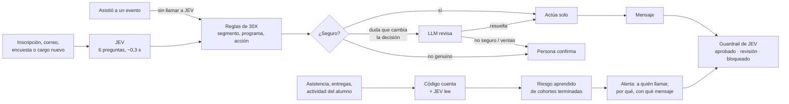

# Playbook: Pálpito para 30X

**Cada persona, en su lugar. Cada alumno, a tiempo.**

Pálpito ubica a cada persona que llega a 30X según su perfil y el momento de su empresa, la reubica cuando su
situación cambia, dice qué contenido o propuesta debe recibir y avisa qué alumno está en riesgo de abandonar un
programa. JEV (TypeSafe AI) toma los juicios rápidos; las reglas de 30X deciden; una persona confirma lo delicado.

Octubre de 2026 · **[PDF de 5 páginas con pantallas](PLAYBOOK.pdf)** · Presentación: [Pálpito para 30X](https://claude.ai/artifact/SA32o8uhYqd2pYWYnnGFxD) · Prototipo: [README](../README.md)

> **Cómo leer las cifras.** Las marcadas *JEV real* se midieron con `jev-1.13.0` sobre 300 inscripciones
> sintéticas con las proporciones de 30X. Las marcadas *demo* salen del motor local con datos sintéticos y muestran
> la mecánica, no la calidad final. Todas se confirman en el piloto con una muestra real de 30X.

---

## 1. Lo que 30X pidió

| Necesidad | En palabras de 30X |
|---|---|
| **Clusterización dinámica** | Que cualquier persona que entra, por ejemplo al inscribirse a un evento en Luma, quede en un segmento según su perfil y el momento de su empresa; que ese segmento se recalcule cada vez que su situación cambia, y que el sistema diga qué contenido o propuesta debería recibir. *«Hoy nuestros segmentos son estáticos.»* |
| **Alertas de riesgo en programas** | Que con la asistencia, las entregas y la actividad de cada alumno, JEV estime quién está en riesgo de abandonar, para que el equipo lo contacte a tiempo. |

**El costo de no tenerlo hoy**

| Dolor | Dato |
|---|---|
| La persona queda mal ubicada | La clasificación actual acierta **55 %** en qué le duele y qué busca cada persona (81 % en el rol) |
| Llega casi sin información | **85 %** no declara qué le duele, **73 %** no dice su rol |
| Queda congelada | El segmento se asigna una vez, al inscribirse, y no cambia aunque la empresa cambie |
| El alumno se va en silencio | Cuando el equipo nota que dejó de asistir, la decisión de irse ya está tomada |

*Fuente: muestra de 697 perfiles anonimizados de 30X (298 con deal, 399 sin deal), proporcional a una base de unas 32.300 personas.*

## 2. Lo que 30X gana

| Trabajo | Resultado | Fuente |
|---|---|---|
| **Clasificar bien** | 99 % de acierto en rol, 100 % en dolor y 99 % en objetivo (hoy: 81, 55 y 55 %) | JEV real |
| **Enviar el contenido correcto** | Detecta el 86 % de los cambios de segmento (precisión 74 %) y cambia la propuesta con ellos | JEV real |
| **Llegar a tiempo al alumno** | Cada semana, la lista de a quién llamar, por qué y con qué mensaje revisado. En la demo, el grupo de riesgo alto abandonó el 63 % de las veces frente al 23 % de la base | Demo |
| **Liberar al equipo** | 94 % de las decisiones sin intervención humana (281 de 300), 96,4 % correctas | JEV real |
| **Cero errores graves** | 0 personas pasadas a ventas sin estar listas, 0 inscripciones trampa procesadas solas | JEV real |

## 3. Cómo funciona

### 3.1 Clusterización dinámica

Una persona, dos finales:

| Momento | Lo que escribe o hace | Hoy | Con Pálpito |
|---|---|---|---|
| Día 0 · Se inscribe en Luma | «No tenemos proceso de ventas, todo depende de referidos» | Queda en un segmento para siempre | Sales Machine · recibe contenido del programa |
| Día 7 · Responde un correo | «¿Cuánto cuesta? ¿Hablamos esta semana?» | Nadie lo nota | Lista para conversar · pasa a un asesor con la nota escrita |
| Día 20 · Asiste a un taller | Sin escribir nada | No cuenta | Compromiso alto · sube su prioridad (en código, sin costo) |
| Día 45 · Cambia de cargo | «Ahora soy la CEO de la compañía» | Le siguen ofreciendo lo mismo | Decisora · Inmersión Ejecutiva |

**Las seis preguntas a JEV** (una sola llamada, unos 0,3 s):

| Pregunta | Respuesta |
|---|---|
| ¿Qué rol tiene? | Una de 7: fundador/CEO, C-level, líder comercial, gerente, técnico, otro, sin dato |
| ¿Describe un problema de su negocio? | Sí / no, con probabilidad |
| ¿Cuál es su problema? | Uno de los 9 dolores de 30X, o ninguno |
| ¿Qué quiere lograr? | Uno de los 10 objetivos de 30X, u otro |
| ¿Qué tan lista está para comprar? | Sin intención · explorando · evaluando · lista para conversar |
| ¿Es una inscripción real? | Sí / no, con probabilidad (frena spam e instrucciones coladas) |

Con esas respuestas, las reglas de 30X calculan la afinidad, eligen el programa (Inmersión Ejecutiva, Sales Machine,
Hardcore AI, AI Sales o ninguno) y la acción: pasar a un asesor, contenido del programa, contenido general o revisión.

**Qué recalcula el segmento**

| Evento | Qué hace Pálpito | Costo |
|---|---|---|
| Responde un correo, contesta una encuesta o cambia de cargo | JEV vuelve a leer el texto nuevo | ≈ USD 0,00007 |
| Asiste a un evento | Recalcula el compromiso en código | USD 0 |
| Lo que infirió JEV tiene más de 30 días | Caduca y se vuelve a preguntar | ≈ USD 0,00007 |

Cada cambio queda en el historial de la persona con el evento que lo causó y la explicación.

### 3.2 Segmentos que se descubren solos

Además de los segmentos de 30X, Pálpito puede descubrir segmentos nuevos en los datos, sin que nadie los defina:

1. Un LLM propone preguntas sobre las columnas de texto (1 a 3 llamadas por descubrimiento, nunca por persona).
2. JEV las responde, persona por persona.
3. El código se queda con las que predicen el resultado (conversión o programa).
4. Agrupa en segmentos y aprende, fuera de muestra, desde qué confianza actuar.
5. Un monitor de deriva detecta cuando la gente nueva ya no encaja y redescubre.

*Demo:* con 600 inscripciones salieron 6 segmentos. Llegaron 240 personas nuevas, el monitor detectó deriva y la
versión 2 tiene 5 segmentos. Apareció uno que nadie buscaba (personas que hablan de cumplir con la
Superintendencia, 34 % de la base, 64 % llegado en el último lote) y 81 de las 240 personas nuevas cambiaron de
segmento, cada una con su porqué. Para 30X es una señal temprana de contenido, campaña o programa.

### 3.3 Alertas de riesgo en programas

| Paso | Quién | Qué hace |
|---|---|---|
| 1 | Código | Cuenta asistencia, faltas seguidas, entregas pendientes o tarde y días sin actividad, al corte de la semana 5 |
| 2 | JEV | Lee lo que escribe el alumno («Me cuesta ver cómo llevar esto a mi realidad») |
| 3 | Código | Aprende de las cohortes terminadas quién abandonó y el umbral desde el cual conviene contactar, fuera de muestra |
| 4 | Pálpito | Cada alerta trae nivel de riesgo, las razones que más pesan, la acción sugerida y el mensaje |
| 5 | JEV | Revisa el mensaje con el guardrail antes de que el equipo lo envíe |

*Demo:* entrenado con 390 alumnos de cohortes terminadas (AUC 0,874 fuera de muestra). En la cohorte en curso de
150 alumnos marca 34 en riesgo alto y 24 en riesgo medio, por unos USD 0,008 en total.

## 4. Arquitectura

- **Rápido donde se puede, humano donde importa:** JEV es el pensamiento rápido; el LLM (Claude) solo entra en la
  duda que cambia la decisión; una persona confirma ventas y casos raros.
- **Conteos y fechas, en código.** A JEV solo se le hacen preguntas cerradas, con opción «sin dato» u «otro».
- **Solo frena la duda que importa:** si la segunda opción de JEV lleva al mismo programa y acción, actúa solo.
- **Privacidad:** nombre y correo nunca se envían a JEV. Corre fuera de los sistemas de 30X.

Detalle técnico: [ARQUITECTURA.md](ARQUITECTURA.md).

## 5. Cuándo pasa a una persona

| Situación | Umbral | Qué pasa |
|---|---|---|
| La inscripción no parece real | p < 0,35 (calibrado con JEV real) | Una persona revisa; el LLM no la toca |
| JEV duda en rol, dolor u objetivo y la duda cambia la decisión | certeza < 0,45 | Revisa el LLM; si duda, una persona |
| Intención de compra no concluyente | p(lista) entre 0,5 y 0,8 | Una persona confirma antes de ventas |
| Rol incierto antes de pasar a ventas | certeza < 0,7 | Una persona confirma |
| Mensaje con promesas, precios o fechas inventadas | guardrail de JEV | Bloqueado o a revisión |
| Todo lo demás | | Actúa solo y lo registra |

Los umbrales se mueven en la vista **Reglas** y el efecto se ve al instante sobre todas las decisiones, sin volver a
llamar a JEV. En los segmentos descubiertos, 30X solo elige el nivel de riesgo: conservador, normal o agresivo.

## 6. Quién lo opera

| Quién | Qué hace |
|---|---|
| Equipo comercial | Atiende la cola de casos dudosos y confirma los pases a ventas |
| Equipo académico y mentores | Revisa las alertas de la semana y contacta a los alumnos en riesgo |
| Líder de growth | Ajusta umbrales, pesos y nivel de riesgo desde el panel |
| Equipo de contenido | Define qué contenido recibe cada programa y segmento |
| Equipo de datos | Corre la evaluación y la calibración cada mes con una muestra etiquetada |

## 7. Cómo se mide

| Métrica | Meta | Hoy |
|---|---|---|
| Acierto en rol / dolor / objetivo | Más que 81 / 55 / 55 % | 99 / 100 / 99 % (JEV real) |
| Pases a ventas indebidos | 0 | 0 (JEV real) |
| Inscripciones trampa procesadas solas | 0 | 0 (JEV real) |
| Decisiones sin intervención humana | A definir con 30X | 94 % (JEV real) |
| Cambios de segmento detectados | A definir con 30X | 86 % (JEV real) |
| Mensajes riesgosos que pasan el guardrail | 0 | 0 de 12; 0 falsas alarmas de 8 |
| Alumnos en riesgo contactados a tiempo | A definir con 30X | Por medir en el piloto |
| Abandono en cohortes con alertas frente a sin alertas | Menor | Por medir en el piloto |
| Latencia p95 | < 500 ms | 358 ms (JEV real) |
| Costo por 1.000 decisiones | < USD 0,10 | USD 0,07 (JEV real) |

## 8. Costo

| Qué | Costo |
|---|---|
| 1.000 decisiones con JEV | USD 0,07 (medido) |
| Reclasificar toda la base (~32.300 personas) | ≈ USD 2,3 |
| Reclasificarla cada día durante un año | ≈ USD 825 con Pálpito, frente a ≈ USD 151.000 con un LLM tradicional (estimado) |
| Asignar 10.000 personas a segmentos descubiertos | ≈ USD 0,71 |
| Alertas de una cohorte de 150 alumnos, con guardrail | ≈ USD 0,008 |

*El estimado del LLM supone la misma entrada y una respuesta de unas 300 palabras por persona.*

## 9. Cómo lo adopta 30X

1. **Validar reglas y programas** con el equipo comercial (Achievers aún no tiene regla).
2. **Piloto en sombra:** con una muestra real revisada por 30X, Pálpito clasifica y marca alertas sin escribirle a
   nadie; se compara con lo que hizo el equipo.
3. **Activar lo de bajo riesgo:** envío de contenido y alertas al equipo académico. Ventas sigue con confirmación humana.
4. **Medir y ajustar cada mes** con las métricas de la sección 7.

## 10. Límites

- Las cifras de JEV real usan inscripciones sintéticas; el texto real es más variado. Con 300 casos y cero errores
  graves, la tasa real podría llegar hasta 1 %.
- Las cifras de segmentos descubiertos y alertas son de la demo con datos sintéticos y el motor local.
- Las descripciones de los programas y sus reglas se infirieron de los datos y deben validarse con 30X.
